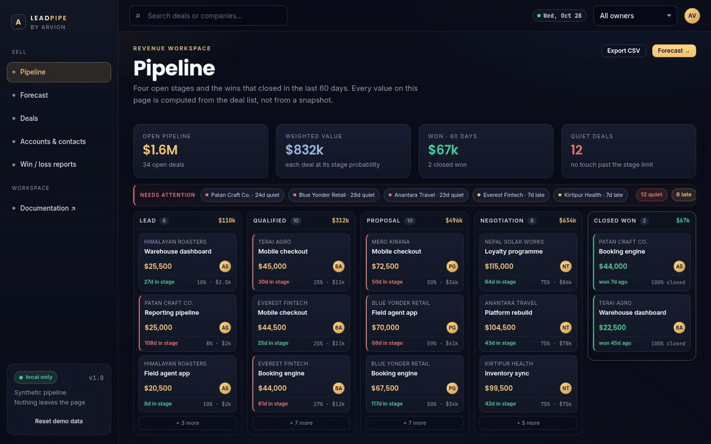
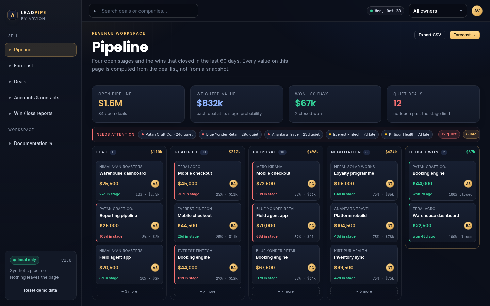

<div align="center">

</div>

<sub>Recorded from the live demo — <a href="docs/demo.mp4">MP4</a> · <a href="docs/screenshot.png">static frame</a></sub>

# Leadpipe

A small CRM that answers three questions without a spreadsheet: what is in the
pipeline, what is it likely worth, and which deals have gone quiet. The whole
thing is a static page plus a few hundred lines of plain ES modules — no
database, no server, no build step.

[**Open the live demo**](https://arvion-technology.github.io/labs/demos/leadpipe/demo/) · [CI](https://github.com/arvion-technology/leadpipe/actions/workflows/ci.yml) · [MIT](LICENSE)

---

Sales tools tend to grow a settings screen before they grow a forecast. This one
is the opposite: the deal list is the only source of truth, and every number on
screen — the weighted total, the monthly forecast, the win rate, the stale-deal
count — is computed from that list when the page renders. The demo ships a
synthetic pipeline of 60 deals, 12 companies and roughly 380 activities, seeded
deterministically so the screenshots and the tests agree.

The parts worth reading are in `src/forecast.js`: probability overrides,
per-stage staleness limits and the commit / weighted / pipeline split — and in
`src/scoring.js`, the five-signal deal health score shown in the drawer.

## What it does

- **Pipeline** — four open stages plus a closed-won column, one card per deal
  with value, owner and days in stage. Stale deals get a red edge.
- **Attention strip** — the deals that have gone quiet past their stage's limit,
  and follow-ups whose date has passed, one click from the activity timeline.
- **Forecast** — committed, weighted and ceiling value for the next five months,
  a quota selector, and a chart of weighted against committed by close month.
- **Deal drawer** — click any card to see a five-signal health score, the
  activity timeline, and move the deal, log a call, or mark it won or lost.
- **Accounts, deals and reports** — a filterable deal table, company and contact
  rollups, win rate by count and by value, lost-reason breakdown and sales
  velocity.

Changes are kept in `localStorage` so a stage move survives a reload. There is a
"Reset demo data" button in the sidebar that restores the seed.

## Screenshots

| Pipeline board | Weighted forecast |
| --- | --- |
|  |  |

## Architecture

```
 demo/index.html ── loads ──► demo/app.js ── imports ──► src/forecast.js
                                   │                        │
                                   ├── imports ──► src/data.js (seeded generator)
                                   │                        │
                              arvion.css / arvion.js        └── STAGES, DAY
                              (shell, charts, tables)

 src/data.js      60 deals, 24 contacts, 12 companies, ~380 activities, one seed
 src/forecast.js  probability, weighted value, staleness, forecast, win/loss,
                  velocity, aging, owner rollups, CSV
 test/            28 node:test cases with a frozen clock
```

`demo/app.js` only renders and wires events. It never recomputes a formula by
hand — if a number appears on screen, a function in `src/forecast.js` produced
it, and that function has a test.

A deal is a plain object:

```js
{
  id: "D-1007",
  name: "Himalayan Roasters — Warehouse dashboard",
  companyId: "c1", contactId: "p1", ownerId: "u1",
  value: 25500,
  stage: "lead",            // lead | qualified | proposal | negotiation
  status: "open",           // open | won | lost
  probability: 0.1,         // optional override, else the stage default
  createdAt: 1780000000000,
  stageEnteredAt: 1781000000000,
  closeDate: 1790000000000,
  lastActivityAt: 1792000000000,
  nextStep: "Send the revised scope",
  nextStepAt: 1793000000000
}
```

## How the forecast is calculated

Each open stage carries a default probability — Lead 10%, Qualified 25%,
Proposal 50%, Negotiation 75%. A salesperson can override it per deal, because
"this one is further along than the stage says" is real information. Closed deals
resolve to 1 or 0 from their status, so a lost deal never inflates a forecast.

```
weighted(deal) = round(value × probability)
```

Monthly buckets come from `closeDate`, not `createdAt`. A deal whose expected
close date has already passed does not vanish — it lands in the current month and
is counted as overdue, which is the difference between a forecast and a wish.

The three columns mean different things:

- **committed** — deals in Negotiation, at full value.
- **weighted** — every open deal at its probability.
- **pipeline** — every open deal at full value, the ceiling.

Staleness is per stage rather than global. Lead allows 7 quiet days, Qualified 10,
Proposal 14, Negotiation 10. A deal with no touch in 24 days at the Lead stage is
not the same problem as a Negotiation deal quiet for 24 days, and the demo flags
them accordingly. `staleInfo(deal)` returns `{ stale, daysSince, limit, overBy }`
so the UI can show how far past the limit it is.

Win rate is reported twice: by count and by value. When they diverge, the team is
winning small deals and losing large ones, which matters more than the average.

## Quickstart

```bash
git clone https://github.com/arvion-technology/leadpipe.git
cd leadpipe
npm test          # 28 tests, no dependencies, Node 20+
npm run demo      # serves the app on http://localhost:4173
```

`package.json` exists so `npm test` and CI have a standard entry point; there is
nothing to install and no runtime dependency. To use the maths from your own
code:

```js
import { forecastByMonth, staleDeals, winLoss } from "./src/forecast.js";

const deals = [
  { value: 20000, stage: "proposal", status: "open", closeDate: Date.now() + 20 * 864e5,
    createdAt: Date.now() - 40 * 864e5, stageEnteredAt: Date.now() - 5 * 864e5,
    lastActivityAt: Date.now() - 2 * 864e5 },
];

const rows = forecastByMonth(deals, { months: 3, now: Date.now(), quota: 180000 });
rows[1];
// { key: "2026-11", committed: 0, weighted: 10000, pipeline: 20000, coverage: 0.056, ... }
```

## Tests

```bash
npm test
```

28 cases on `node:test`, all with a fixed `now` (2026-10-28T12:00Z) so time-based
logic is deterministic: stage probability and overrides, weighted rounding,
per-stage staleness and threshold overrides, stale ordering, monthly bucketing,
overdue close dates, the commit/weighted/pipeline split, won revenue by month, win
rate by count and value, reason aggregation, cycle time, sales velocity, aging
boundaries, owner rollups, follow-up ordering, timeline ordering, activity
windows, funnel monotonicity, month helpers across a year boundary, CSV escaping,
the seeded dataset's determinism, and the five health-score factors, their
bands and the closed-deal short circuit.

The demo has its own static check:

```bash
node scripts/serve-check.mjs
```

## Limitations

It is a demo, not a CRM you can hand to a sales team. There is no server, no
authentication, no multi-user sync and no audit log — two people editing the same
pipeline would overwrite each other. Currency is hard-coded to USD and there is
no per-deal currency conversion. The forecast has no seasonality and no historical
snapshot, so it cannot show forecast-versus-actual accuracy over time; that would
need a period table recording what was forecast at each month end. Reporting is
single-window (180 days) rather than quarter-over-quarter.

The seeded companies and contacts are invented. They exist to make the charts
legible, not to imply customers.

## Project layout

```text
leadpipe/
├── demo/
│   ├── index.html      # five views: pipeline, forecast, deals, accounts, reports
│   ├── app.js          # rendering, drawer, filters, localStorage
│   ├── styles.css      # board, drawer and forecast table
│   ├── arvion.css      # design tokens and shell (shared, not edited)
│   └── arvion.js       # charts, tables, formatting (shared, not edited)
├── src/
│   ├── data.js         # seeded dataset and the stage constants
│   ├── forecast.js     # the maths, as pure functions with an injected clock
│   └── scoring.js      # five-signal deal health score
├── test/               # 22 node:test cases
├── scripts/            # static server, screenshots, bundle checks
└── .github/workflows/  # CI: tests on Node 20 and 22
```

## Credits

Built by [Arvion Technologies](https://arviontech.net) in Kathmandu as part of our
open-source [Labs](https://github.com/arvion-technology/labs) series. We build
web platforms, mobile apps and internal tools for clients; if you need a CRM
inside your own product, this is a fair sample of how we start.

MIT licensed.
